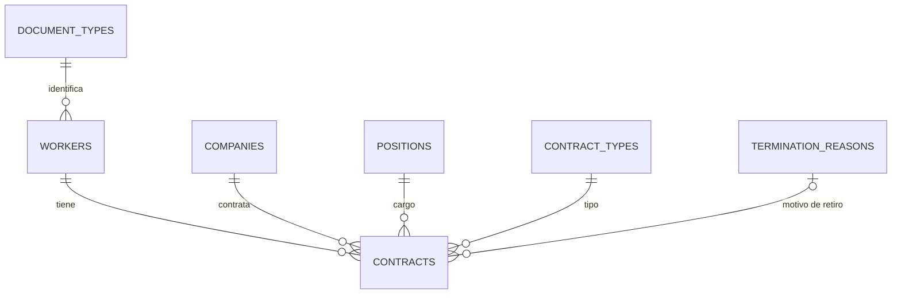

# Liquidación de contratos laborales

_Por favor usar ctrl + Shift + V para leer el siguiente readme.md y también la DOCUMENTACION.md_

Aplicación web en **Laravel** para gestionar trabajadores, empresas y contratos, y liquidar **prestaciones sociales e indemnización** (Art. 64 C.S.T.) según el formato estándar de la prueba técnica. Cada contrato liquidado se puede exportar a Excel en el formato original.

- **Backend y frontend:** Laravel 11+ · Blade · Bootstrap 5 (responsive)
- **Base de datos:** MySQL / MariaDB (XAMPP)
- **Exportación:** PhpSpreadsheet sobre la plantilla Excel original
- **Roles:** Administrador y Colaborador

---

## Contenido

1. [Requisitos](#1-requisitos)
2. [Preparar XAMPP](#2-preparar-xampp)
3. [Clonar el repositorio](#3-clonar-el-repositorio)
4. [Instalar dependencias](#4-instalar-dependencias)
5. [Configurar el entorno (.env)](#5-configurar-el-entorno-env)
6. [Crear la base de datos](#6-crear-la-base-de-datos)
7. [Migrar y cargar datos iniciales](#7-migrar-y-cargar-datos-iniciales)
8. [Ejecutar la aplicación](#8-ejecutar-la-aplicación)
9. [Credenciales de acceso](#9-credenciales-de-acceso)
10. [Pruebas](#10-pruebas)
11. [Funcionalidades y permisos](#11-funcionalidades-y-permisos)
12. [Modelo de datos](#12-modelo-de-datos)
13. [Estructura del proyecto](#13-estructura-del-proyecto)
14. [Solución de problemas](#14-solución-de-problemas)

---

## 1. Requisitos

| Herramienta                             | Versión                | Para qué              |
| --------------------------------------- | ---------------------- | --------------------- |
| [XAMPP](https://www.apachefriends.org/) | Con PHP 8.2 o superior | Apache, MySQL y PHP   |
| [Composer](https://getcomposer.org/)    | 2.x                    | Dependencias de PHP   |
| [Git](https://git-scm.com/)             | Cualquiera reciente    | Clonar el repositorio |

Comprobar desde una terminal (CMD o PowerShell):

```bash
php -v
composer -V
git --version
```

Si `php` no se reconoce, agregue `C:\xampp\php` a la variable de entorno `PATH` de Windows y abra una terminal nueva.

---

## 2. Preparar XAMPP

### 2.1 Activar extensiones de PHP

Abra `C:\xampp\php\php.ini` y verifique que estas líneas **no** tengan `;` al inicio (si lo tienen, quítelo):

```ini
extension=zip
extension=gd
extension=mbstring
extension=fileinfo
extension=pdo_mysql
extension=openssl
```

Guarde el archivo.

### 2.2 Iniciar los servicios

En el **Panel de control de XAMPP** presione **Start** en:

- **Apache**
- **MySQL**

Si cambió `php.ini` con Apache ya iniciado, reinícielo (Stop → Start).

---

## 3. Clonar el repositorio

Clone el proyecto dentro de la carpeta pública de Apache (`htdocs`):

```bash
cd C:\xampp\htdocs
git clone https://github.com/<usuario>/<repositorio>.git liquidaciones
cd liquidaciones
```

> Reemplace `<usuario>/<repositorio>` por la URL real de su repositorio. El nombre de carpeta `liquidaciones` (último argumento) determina la URL de acceso del paso 8.

---

## 4. Instalar dependencias

```bash
composer install
```

Esto descarga Laravel y todas las librerías (incluida la de Excel) en la carpeta `vendor/`, que no se sube a GitHub.

---

## 5. Configurar el entorno (.env)

Cree el archivo de entorno a partir del ejemplo y genere la clave de la aplicación:

```bash
copy .env.example .env
php artisan key:generate
```

(En PowerShell o Git Bash puede usar `cp .env.example .env`.)

Abra `.env` con un editor y ajuste estas variables:

```env
APP_NAME="Liquidaciones"
APP_URL=http://localhost/liquidaciones/public
APP_LOCALE=es

DB_CONNECTION=mysql
DB_HOST=127.0.0.1
DB_PORT=3306
DB_DATABASE=liquidaciones
DB_USERNAME=root
DB_PASSWORD=
```

> En XAMPP, MySQL trae por defecto el usuario `root` **sin contraseña**. Si usted definió una, colóquela en `DB_PASSWORD`.

---

## 6. Crear la base de datos

1. Abra **phpMyAdmin**: <http://localhost/phpmyadmin>
2. Pestaña **Bases de datos**.
3. Nombre: `liquidaciones` · Cotejamiento: `utf8mb4_unicode_ci`.
4. Clic en **Crear**.

O por línea de comandos:

```bash
C:\xampp\mysql\bin\mysql.exe -u root -e "CREATE DATABASE liquidaciones CHARACTER SET utf8mb4 COLLATE utf8mb4_unicode_ci;"
```

El nombre debe coincidir con `DB_DATABASE` del `.env`.

---

## 7. Migrar y cargar datos iniciales

```bash
php artisan migrate --seed
```

Este comando:

- Crea todas las tablas (usuarios, trabajadores, empresas, contratos y catálogos).
- Carga los catálogos: tipos de documento, cargos, motivos de retiro, tipos de contrato y SMLMV por año.
- Crea los dos usuarios de acceso.
- Carga datos de ejemplo, incluidos los dos casos del Excel de la prueba.

Para empezar sin datos de ejemplo, quite la línea `DemoDataSeeder::class` de `database/seeders/DatabaseSeeder.php` antes de ejecutar el comando.

Para reiniciar todo desde cero: `php artisan migrate:fresh --seed` (**borra** todos los datos).

---

## 8. Ejecutar la aplicación

### Opción A — Con Apache de XAMPP (recomendada)

Con Apache y MySQL iniciados, abra:

**<http://localhost/liquidaciones/public>**

### Opción B — Dominio local limpio (virtual host)

1. Edite `C:\xampp\apache\conf\extra\httpd-vhosts.conf` y agregue:

    ```apache
    <VirtualHost *:80>
        ServerName liquidaciones.test
        DocumentRoot "C:/xampp/htdocs/liquidaciones/public"
        <Directory "C:/xampp/htdocs/liquidaciones/public">
            AllowOverride All
            Require all granted
        </Directory>
    </VirtualHost>
    ```

2. Abra el Bloc de notas **como administrador**, edite `C:\Windows\System32\drivers\etc\hosts` y añada la línea:

    ```
    127.0.0.1   liquidaciones.test
    ```

3. Cambie `APP_URL=http://liquidaciones.test` en `.env` y reinicie Apache.
4. Abra <http://liquidaciones.test>.

### Opción C — Servidor de desarrollo de Laravel

No requiere Apache (MySQL sí debe estar iniciado):

```bash
php artisan serve
```

Abra <http://127.0.0.1:8000>.

---

## 9. Credenciales de acceso

| Rol           | Correo                     | Contraseña    |
| ------------- | -------------------------- | ------------- |
| Administrador | `admin@blindem.test`       | `Admin12345*` |
| Colaborador   | `colaborador@blindem.test` | `Colab12345*` |

> Son credenciales de demostración. **Cámbielas** antes de usar la aplicación fuera de un entorno local.

---

## 10. Pruebas

```bash
php artisan test --filter=LiquidationCalculatorTest
```

Verifican que el motor de cálculo reproduce los valores de las dos hojas del Excel (netos de **$ 3.180.899** y **$ 7.614.926**) y los casos límite: término fijo, un año o menos de servicio y salarios sin auxilio de transporte.

---

## 11. Funcionalidades y permisos

| Capacidad                                                                                             | Colaborador | Administrador |
| ----------------------------------------------------------------------------------------------------- | :---------: | :-----------: |
| Consultar contratos e historial por trabajador y por empresa                                          |      ✔      |       ✔       |
| Pantalla de liquidación con filtros por estado, tipo y número de documento                            |      ✔      |       ✔       |
| Exportar cada contrato a Excel                                                                        |      ✔      |       ✔       |
| CRUD de contratos                                                                                     |      ✔      |       ✔       |
| CRUD de trabajadores y empresas                                                                       |      —      |       ✔       |
| CRUD de tablas paramétricas (tipos de documento, cargos, motivos de retiro, tipos de contrato, SMLMV) |      —      |       ✔       |

**Flujo básico de uso**

1. Ingrese como **administrador** y verifique los catálogos en el menú **Parámetros** (en especial el SMLMV del año de retiro).
2. Registre trabajadores y empresas.
3. Cree un contrato; al registrar la **fecha de retiro** y el **motivo**, queda listo para liquidar.
4. En **Liquidación**, filtre y abra el detalle del cálculo.
5. Use **Exportar a Excel** para descargar el formato diligenciado.

**Reglas principales del cálculo**

| Concepto                     | Fórmula                                                                                |
| ---------------------------- | -------------------------------------------------------------------------------------- |
| Cesantías                    | `(base prestacional × días) / 360`                                                     |
| Intereses sobre cesantías    | `(cesantías × días × 12%) / 360`                                                       |
| Prima de servicios           | `(base prestacional × días) / 360`                                                     |
| Vacaciones                   | `(base vacaciones × días) / 720`                                                       |
| Indemnización (indefinido)   | 30 días el primer año + 20 por año adicional (salario < 10 SMLMV); 20 + 15 si es mayor |
| Indemnización (término fijo) | Salario diario × días que faltaban para el fin pactado                                 |
| Deducciones                  | Salud 4 % y pensión 4 % sobre salario pendiente y vacaciones, más préstamos y otras    |

La indemnización solo se calcula si el **motivo de retiro** tiene activada la marca _genera indemnización_ (por defecto, «Despido sin justa causa»). La base prestacional es salario + auxilio de transporte + promedio de extras; el auxilio solo aplica a salarios de hasta 2 SMLMV.

---

## 12. Modelo de datos



`contracts` es la entidad asociativa entre trabajadores y empresas: un trabajador puede tener varios contratos con distintas empresas. Las claves foráneas son `RESTRICT`: un registro en uso no puede eliminarse. `minimum_wages` (SMLMV por año) y `users` no tienen relaciones.

---

## 13. Estructura del proyecto

```
app/
  Http/Controllers/     Auth, Dashboard, Worker, Company, Contract, Liquidation, Catalog
  Http/Middleware/      EnsureRole (control de acceso por rol)
  Http/Requests/        ContractRequest (validación de contratos)
  Models/               Worker, Company, Contract y catálogos
  Services/             LiquidationCalculator (motor) · LiquidationExporter (Excel)
config/catalogs.php     Definición de las tablas paramétricas (CRUD genérico)
database/migrations     Esquema de la base de datos
database/seeders        Catálogos, usuarios y datos de ejemplo
resources/templates     Plantilla Excel original usada al exportar
resources/views         Vistas Blade + Bootstrap
routes/web.php          Rutas y permisos por rol
tests/Unit              Pruebas del motor de cálculo
```

---

## 14. Solución de problemas

| Síntoma                                            | Causa probable                               | Solución                                                             |
| -------------------------------------------------- | -------------------------------------------- | -------------------------------------------------------------------- |
| `php` no se reconoce como comando                  | PHP de XAMPP fuera del `PATH`                | Agregar `C:\xampp\php` al `PATH` y abrir una terminal nueva          |
| `composer install` falla por `ext-zip` o `ext-gd`  | Extensión desactivada                        | Activarla en `php.ini` (sección 2.1) y repetir                       |
| `could not find driver`                            | `pdo_mysql` desactivado                      | Activar `extension=pdo_mysql` en `php.ini` y reiniciar Apache        |
| `SQLSTATE[HY000] [1049] Unknown database`          | La base no existe                            | Crearla (sección 6) con el mismo nombre del `.env`                   |
| `Access denied for user 'root'`                    | Contraseña de MySQL distinta                 | Ajustar `DB_PASSWORD` en `.env`                                      |
| `No application encryption key has been specified` | Falta la clave                               | `php artisan key:generate`                                           |
| 404 en todas las rutas salvo la raíz               | `mod_rewrite` o `AllowOverride` desactivados | Activar `mod_rewrite` en Apache y `AllowOverride All`                |
| Pantalla sin estilos                               | Bootstrap se carga por CDN y no hay internet | Conectarse a internet                                                |
| «No hay SMLMV parametrizado para el año X»         | Falta ese año en el catálogo                 | Crearlo en **Parámetros → SMLMV**                                    |
| «Contrato a plazo determinado sin fecha pactada»   | Falta la fecha de terminación pactada        | Editar el contrato y completarla                                     |
| No se puede eliminar un registro                   | Está referenciado por otros datos            | Es la restricción esperada: reasigne o elimine primero lo que lo usa |
| Cambios en `.env` o rutas sin efecto               | Caché de configuración                       | `php artisan optimize:clear`                                         |
| Error de migración a medias                        | Ejecución interrumpida                       | `php artisan migrate:fresh --seed` (borra los datos)                 |

---

## Notas

- El SMLMV de cada año se gestiona en **Parámetros → SMLMV**. Los valores cargados son de referencia: verifique el vigente antes de liquidar.
- La exportación escribe los valores calculados sobre la plantilla, de modo que el Excel y la pantalla coinciden siempre.
- Documentación técnica ampliada (arquitectura, diccionario de datos y motor de cálculo): `DOCUMENTACION.docx` / `DOCUMENTACION.md`.
